# 🎵 Awesome Audio DSP & Real-Time Sound Synthesis 🔊

  
  
  
  
  
  

  <strong>A curated directory of top-tier Digital Signal Processing (DSP) libraries, real-time sound synthesis engines, browser-based & desktop DAWs, audio plugin frameworks (VST3/AU/CLAP/LV2), and music production SaaS platforms.</strong>

---

## 📑 Table of Contents
- [🌐 Sector Overview & Market Dynamics](#-sector-overview--market-dynamics)
- [☁️ SaaS & Cloud Music Production Platforms](#️-saas--cloud-music-production-platforms)
- [💻 Open-Source DSP, DAWs & Synthesis Engines](#-open-source-dsp-daws--synthesis-engines)
  - [🎛️ Digital Audio Workstations (DAWs) & DJ Software](#️-digital-audio-workstations-daws--dj-software)
  - [⚡ Audio DSP Frameworks & Plugin Toolkits](#-audio-dsp-frameworks--plugin-toolkits)
  - [🎹 Sound Synthesis, Modular & Sound Computing Systems](#-sound-synthesis-modular--sound-computing-systems)
- [📈 Star History](#-star-history)
- [🤝 How to Contribute](#-how-to-contribute)
- [💖 Support & Sponsorship](#-support--sponsorship)
- [⚠️ Disclaimer](#️-disclaimer)

---

## 🌐 Sector Overview & Market Dynamics

The global music production software and audio tech sector represents an estimated addressable market of **$1.5B to $3.5B+**, accelerating at a **7.5%–12% CAGR** powered by the creator economy, cloud Web Audio adoption, and AI-assisted mixing workflows. The sector exhibits a **moderately fragmented** structure: traditional DAWs and creative workstation software remain distributed among established studio staples, while high-velocity creator segments (stem separation, cloud mastering, sample curation) see aggressive multi-product consolidation alongside a resilient, thriving open-source C++ and WebAssembly DSP ecosystem.

---

## ☁️ SaaS & Cloud Music Production Platforms

The table below compiles leading hosted audio production services, collaborative cloud DAWs, AI mastering platforms, and plugin subscription suites, ordered by company size (valuation/market cap/scale).

| Platform | Category | Company Scale (Valuation / Revenue) | Pricing (Specific Starting Paid Tier) | Free Tier / Trial Limit |
| :--- | :--- | :--- | :--- | :--- |
| **[Soundtrap](https://www.soundtrap.com/)** | Cloud Collaborative DAW | **~$110B Market Cap** *(Spotify)* | **$11.99 / month** (Music Production / Sound Starter) | **Free forever plan**: Unlimited projects, 200+ instruments, 2,200+ loops; exports restricted to standard quality MP3/OGG only (no WAV export, no Antares Auto-Tune) |
| **[Splice](https://splice.com/)** | Cloud Sample Library & VST Hub | **~$500M Valuation** (~$100M+ revenue) | **$12.99 / month** (*Sounds+* tier, 100 sample credits/mo) | **Free account limit**: Unlimited search and sample previews, Create Stacks mode access; zero monthly sample downloads/exports (sample downloads require paid tier) |
| **[BandLab](https://www.bandlab.com/)** | Mobile & Browser DAW | **$425M Valuation** (~$45M–$48M revenue) | **$14.95 / month** (*BandLab Membership*) | **Free forever plan**: Capped at 16 tracks per project, 20 sample downloads per month, 5 beat generation runs per week; no streaming distribution included |
| **[iZotope](https://www.izotope.com/)** | Audio Mastering & Restoration Suite | **~$300M+ Portfolio** *(inMusic / Soundwide)* | **$15.00 / month** (*iZotope Plus*) | **7-day free trial**: Unrestricted full access to all included plugins; requires cancellation before day 7 ends to prevent automated subscription billing |
| **[Native Instruments](https://www.native-instruments.com/)** | Virtual Instruments & Sampling | **~$300M+ Portfolio** *(inMusic / Soundwide)* | **$14.99 / month** (*NI 360 Essentials*) | **14-day free trial**: Unrestricted access to entire tier instrument and effect suite; non-expiring free Kontakt Player provided with limited bundled starter sounds |
| **[LANDR](https://www.landr.com/)** | AI Audio Mastering & Distribution | **~$150M–$250M Valuation** (~$12M+ revenue) | **$11.99 / month** (*LANDR Studio Standard*, billed annually) | **Free account limit**: Unlimited AI master audition previews and 4 GB cloud workspace storage; downloading mastered WAV files and streaming distribution require payment |
| **[Waves Creative Access](https://www.waves.com/)** | Professional DSP Plugin Suite | **~$20M–$100M Revenue** (Privately held) | **$14.99 / month** (*Waves Essential*, 110+ plugins) | **7-day free trial**: Full access to all plugins in selected tier; standalone plugins revert to periodic audio mute/dropout demo mode without active license |
| **[Audiotool](https://www.audiotool.com/)** | Collaborative Web Modular DAW | **~$5.3M Valuation** (~$1.2M revenue) | **$0.00 / month** (100% Free platform supported by partners) | **Free forever plan**: Unlimited projects, unlimited tracks, full access to all 37 built-in synthesis and FX devices, modular routing, and cloud collaboration with zero paywalls |

---

## 💻 Open-Source DSP, DAWs & Synthesis Engines

This section highlights production-ready open-source DAWs, real-time signal processing toolkits, hybrid synthesis engines, and plugin SDKs. Repositories are organized with real-time star badges linking to each project's stargazers page and ranked by star count.

### 🎛️ Digital Audio Workstations (DAWs) & DJ Software

| Project | Description | Tech Stack | Stars |
| :--- | :--- | :--- | :--- |
| **[Audacity](https://github.com/audacity/audacity)** | Multi-track audio editor and recorder for Windows, macOS, and Linux | C++, wxWidgets |  |
| **[LMMS](https://github.com/LMMS/lmms)** | Cross-platform music production digital audio workstation | C++, Qt |  |
| **[Mixxx](https://github.com/mixxxdj/mixxx)** | Advanced open-source DJ software with real-time sound processing, pitch control & stem mixing | C++, Qt |  |
| **[Ardour](https://github.com/Ardour/ardour)** | Professional-grade digital audio workstation with multi-channel recording, editing, and mixing | C++, GTK |  |
| **[Zrythm](https://github.com/zrythm/zrythm)** | Highly automated, intuitive DAW with flexible signal routing and chord assistant | C, C++, GTK4 |  |
| **[openDAW](https://github.com/andremichelle/openDAW)** | Next-generation web-native digital audio workstation built on Web Audio API and WASM | TypeScript, Web Audio |  |
| **[GridSound](https://github.com/gridsound/daw)** | Free in-browser work-in-progress DAW following standard Web Audio architectures | JavaScript, Web Audio |  |
| **[DawDreamer](https://github.com/DBraun/DawDreamer)** | Python-native digital audio workstation with VST instruments, FAUST DSP, and automation | Python, C++, FAUST | [ |

### ⚡ Audio DSP Frameworks & Plugin Toolkits

| Project | Description | Tech Stack | Stars |
| :--- | :--- | :--- | :--- |
| **[JUCE](https://github.com/juce-framework/JUCE)** | Industry-standard C++ framework for cross-platform audio plugins (VST3, AU, AAX) and desktop apps | C++ |  |
| **[Pedalboard](https://github.com/spotify/pedalboard)** | Python audio processing, DSP effects chain, and VST3/AU host developed by Spotify | Python, C++ |  |
| **[Faust](https://github.com/grame-cncm/faust)** | Functional programming language for real-time sound synthesis and DSP compiling to C++, Rust, and WASM | C++, Faust |  |
| **[nih-plug](https://github.com/robbert-vdh/nih-plug)** | High-performance Rust audio plugin framework supporting VST3 and CLAP formats | Rust |  |
| **[iPlug2](https://github.com/iPlug2/iPlug2)** | Cross-platform C++ audio plugin framework targeting desktop, mobile, XR, and Web (WASM) | C++ | [ |
| **[KFR](https://github.com/kfrlib/kfr)** | Fast, modern C++ DSP framework featuring vector FFT, sample rate conversion, and FIR/IIR filtering | C++, SIMD |  |
| **[HISE](https://github.com/christophhart/HISE)** | Open-source framework for building high-performance sample-based virtual instruments | C++, JUCE |  |
| **[STK](https://github.com/thestk/stk)** | The Synthesis ToolKit in C++ — algorithmic sound synthesis and physical acoustic modeling | C++ |  |

### 🎹 Sound Synthesis, Modular & Sound Computing Systems

| Project | Description | Tech Stack | Stars |
| :--- | :--- | :--- | :--- |
| **[SuperCollider](https://github.com/supercollider/supercollider)** | Real-time audio synthesis engine, dynamic language (`sclang`), and algorithmic composition environment | C++, SuperCollider |  |
| **[Bespoke Synth](https://github.com/BespokeSynth/BespokeSynth)** | Software modular synthesizer and live patchable generative sound environment | C++, JUCE |  |
| **[VCV Rack](https://github.com/VCVRack/Rack)** | The virtual Eurorack modular synthesizer platform with extensive plugin module support | C++, OpenGL |  |
| **[Surge](https://github.com/surge-synthesizer/surge)** | Legendary open-source hybrid synthesizer plugin featuring wavetable, FM, and analog modeling | C++ |  |
| **[Helm](https://github.com/mtytel/helm)** | Polyphonic subtractive synthesizer with visual modulation routing and visual envelopes | C++, JUCE |  |
| **[Pure Data](https://github.com/pure-data/pure-data)** | Real-time visual dataflow programming language for electronic music, DSP, and sound analysis | C, Tcl/Tk |  |
| **[Csound](https://github.com/csound/csound)** | Renowned sound computing and algorithmic audio synthesis programming language | C, C++ |  |
| **[ZynAddSubFX](https://github.com/zynaddsubfx/zynaddsubfx)** | Advanced polyphonic synthesizer with additive, subtractive, and pad synthesis engines | C++, FLTK |  |

---

## 📈 Star History

---

## 🤝 How to Contribute

Contributions are warmly encouraged! Follow these steps to help keep this curated resource fresh and authoritative:

1. 🍴 **Fork** this repository.
2. 🌿 **Create a feature branch**: `git checkout -b feature/add-new-audio-tool`.
3. 📝 **Add or update entries** following the established format:
   - For **SaaS tools**, ensure specific paid starting tier pricing and concrete free-tier/trial limits are stated.
   - For **Open-Source projects**, include the repository name, GitHub star badge (`style=social&color=white` linking to the stargazers page), a concise one-sentence description, and its core tech stack.
4. ✅ **Ensure accuracy**: Verify links, repository active status, and descriptions.
5. 🚀 **Submit a Pull Request** with a brief summary of the added tool.

---

## 💖 Support & Sponsorship

Thank you for exploring and building with **Awesome Audio DSP & Real-Time Sound Synthesis**! If you find this directory valuable for your research, music production, or audio engineering projects, please consider supporting the project:

- ⭐ **Star this repository** to help others discover it.
- 🔀 **Fork & share** with fellow audio engineers, musicians, and developers.
- ☕ **Buy a coffee or sponsor ongoing maintenance**: Support directly via the [GitHub Sponsors Dashboard](https://github.com/sponsors/ishandutta2007).

---

## ⚠️ Disclaimer

- This is a community-curated directory intended for research, software discovery, and educational purposes. Inclusion does not imply official endorsement.
- Real-time digital signal processing produces sudden amplitude fluctuations and high sound pressure levels; please safeguard your hearing and configure appropriate limiter/safety thresholds during testing.
- Pricing, trial periods, and terms of SaaS services are subject to change by their respective providers.

---

  Maintained with ❤️ by the open-source audio tech community.

